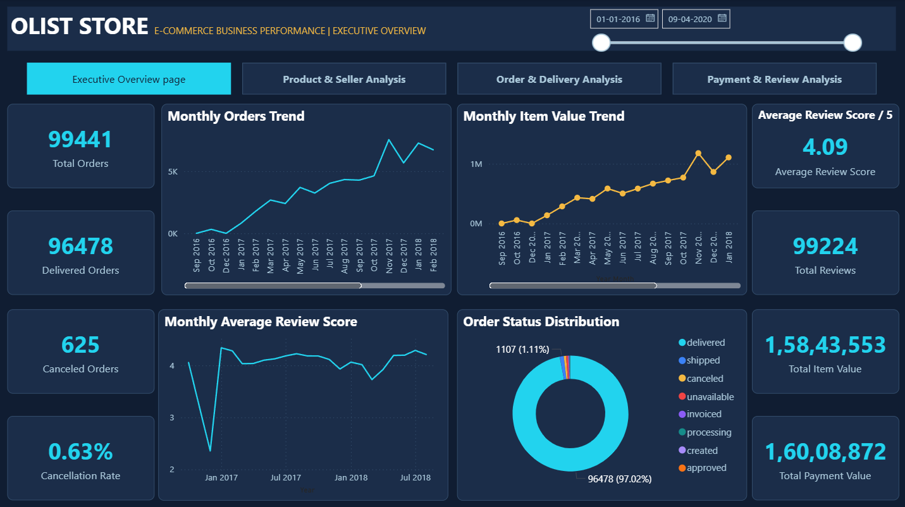
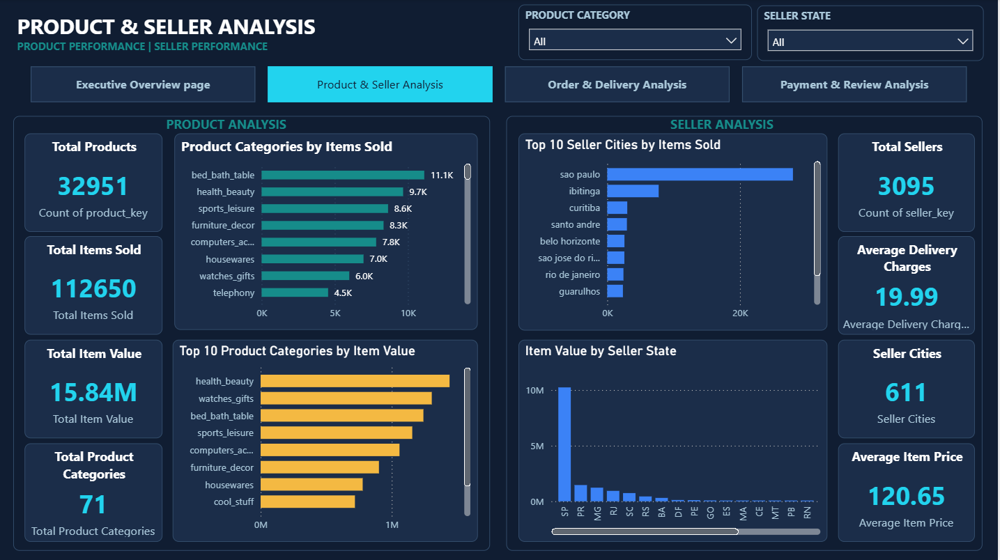
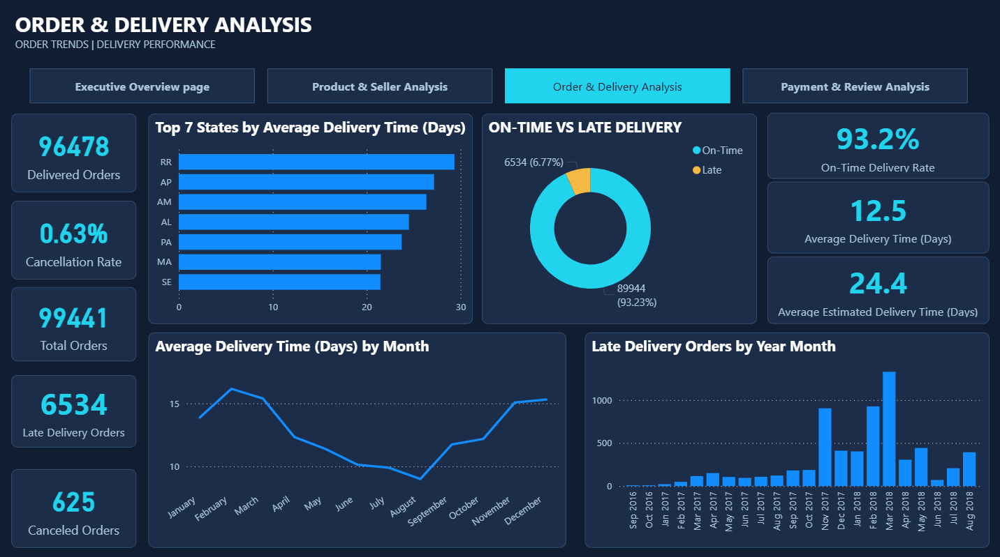
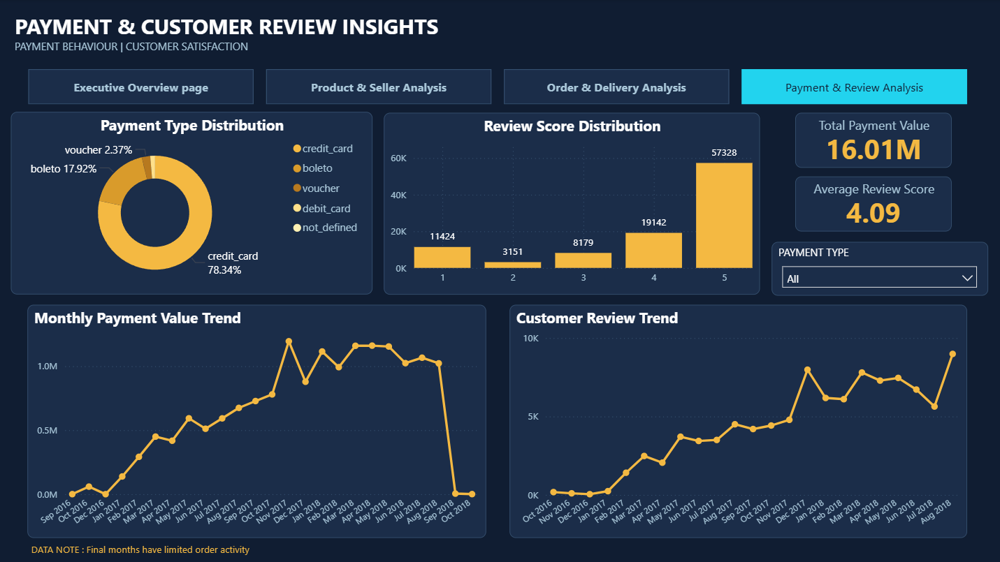

# OlistStore SQL Data Warehouse

**An end-to-end SQL Server Data Warehouse and Power BI analytics project using the Medallion Architecture.**

## Project Overview

OlistStore SQL Data Warehouse is an end-to-end data warehousing and business intelligence project built using Microsoft SQL Server and Power BI.

The project uses the Brazilian E-Commerce Public Dataset by Olist and implements the **Medallion Architecture (Bronze, Silver, and Gold)** to transform raw e-commerce data into structured, clean, and business-ready datasets.

The final Gold layer follows a Star Schema design and contains fact and dimension tables used to build interactive Power BI dashboards and generate business insights.

## Project Objectives

- Build a structured SQL Data Warehouse using SQL Server.
- Implement Bronze, Silver, and Gold data layers.
- Perform data cleaning and transformations using T-SQL.
- Design fact and dimension tables using a Star Schema.
- Implement data quality checks and validation.
- Perform business analysis using SQL queries.
- Develop interactive Power BI dashboards.

## Technology Stack

| Technology | Purpose |
|---|---|
| Microsoft SQL Server | Data warehouse |
| T-SQL | Data loading, transformation and analysis |
| Microsoft Power BI | Data visualization and reporting |
| Python | Supporting data profiling and exploration |
| Git & GitHub | Version control and project management |

## Data Warehouse Architecture

The project follows the Medallion Architecture.

```text
              Olist CSV Dataset
                     |
                     v
               BRONZE LAYER
                  Raw Data
                     |
                     v
               SILVER LAYER
          Cleaned & Transformed Data
                     |
                     v
                GOLD LAYER
           Fact & Dimension Tables
                (Star Schema)
                     |
                     v
                 POWER BI
           Interactive Dashboards
```

### Bronze Layer

- Created database schemas and raw tables.
- Loaded source CSV datasets directly into SQL Server using `BULK INSERT`.
- Identified relationships between source tables.
- Performed initial data validation.

### Silver Layer

- Cleaned and transformed raw data.
- Handled duplicates and data quality issues.
- Standardized data for analytical use.
- Compared Bronze and Silver record counts.

### Gold Layer

- Created fact and dimension tables.
- Implemented a Star Schema.
- Loaded analytical data into the Gold layer.
- Validated records, relationships and data quality.

**Gold Layer: 10 Tables**

- 6 Dimension Tables
- 4 Fact Tables

## Power BI Dashboard

The Power BI dashboard contains four main analytical pages:

1. **Executive Overview** – Overall business performance, order trends and customer reviews.
2. **Product & Seller Analysis** – Product category performance and seller analysis.
3. **Order & Delivery Analysis** – Delivery performance, delivery time and on-time delivery.
4. **Payment & Customer Review Insights** – Payment methods and customer review analysis.

### Dashboard Screenshots

**1. Executive Overview**



**2. Product & Seller Analysis**



**3. Order & Delivery Analysis**



**4. Payment & Customer Review Insights**



### Additional Dashboard Features

- Interactive slicers
- Drill-through analysis
- Custom tooltips
- KPI cards
- Monthly trend analysis
- Dark navy dashboard theme

The Power BI report is available in `powerbi/Dashboard.pbix`.

## Dataset

**Brazilian E-Commerce Public Dataset by Olist**

Source: [Kaggle – Brazilian E-Commerce Public Dataset](https://www.kaggle.com/datasets/olistbr/brazilian-ecommerce)

The dataset contains information about:

- Customers
- Orders
- Order items
- Payments
- Reviews
- Products
- Sellers
- Geolocation
- Product category translations

Dataset attribution belongs to the original Olist dataset providers.

**Note:** Source CSV files are not included in the GitHub repository. Download the dataset from Kaggle and place the CSV files in the local `dataset/` folder before running the SQL loading scripts.

## Repository Structure

```text
OlistStore-SQL-Data-Warehouse/
|
|-- dataset/
|   |-- .gitkeep
|
|-- docs/
|   |-- Dashboard_screenshots/
|   |   |-- Executive_Overview.png
|   |   |-- Product_Seller_Analysis.png
|   |   |-- Order_Delivery_Analysis.png
|   |   |-- Payment_Customer_Reviews.png
|   |
|   |-- BRONZE_ER_DIAGRAM.png
|   |-- GOLD_ER_DIAGRAM.png
|   |-- PROJECT_DOCUMENTATION.txt
|   |-- Power_BI_Implementation_Flow.txt
|
|-- powerbi/
|   |-- Dashboard.pbix
|
|-- scripts/
|   |-- bronze/
|       |-- inspect_dataset.py
|       |-- profile_dataset.py
|
|-- sql/
|   |-- bronze/
|   |   |-- CreateDatabase_schemas.sql
|   |   |-- create_bronze_tables.sql
|   |   |-- identify_bronze_relationships.sql
|   |   |-- load_bronze_tables.sql
|   |   |-- validate_bronze_data.sql
|   |   |-- verify_bronze_loads.sql
|   |
|   |-- silver/
|   |   |-- compare_bronze_vs_silver.sql
|   |   |-- create_silver_tables.sql
|   |   |-- transform_silver_data.sql
|   |
|   |-- gold/
|       |-- create_gold_tables.sql
|       |-- gold_analysis_queries.sql
|       |-- gold_business_queries.sql
|       |-- load_gold_dimensions.sql
|       |-- load_gold_facts.sql
|       |-- validate_gold.sql
|
|-- .gitignore
|-- README.md
```

## How to Run the Project

1. Install Microsoft SQL Server and SQL Server Management Studio (SSMS).
2. Download the Olist dataset from Kaggle.
3. Place the original CSV files in the local `dataset/` folder.
4. Configure the dataset file paths in the Bronze loading SQL script.
5. Execute the Bronze database and table creation scripts.
6. Load the raw CSV datasets into the Bronze layer using `BULK INSERT`.
7. Execute the Silver table creation and transformation scripts.
8. Execute the Gold table creation and loading scripts.
9. Run the Gold validation and business analysis queries.
10. Open `powerbi/Dashboard.pbix` in Power BI Desktop.
11. Configure the SQL Server connection to your local data warehouse and refresh the report.

Refer to `docs/PROJECT_DOCUMENTATION.txt` and `docs/Power_BI_Implementation_Flow.txt` for additional implementation details.

## Project Status

**Completed** – Bronze, Silver and Gold data warehouse layers, SQL validation, business analysis and Power BI dashboard implementation.

---

**Developed as a portfolio project using SQL Server, T-SQL and Power BI.**